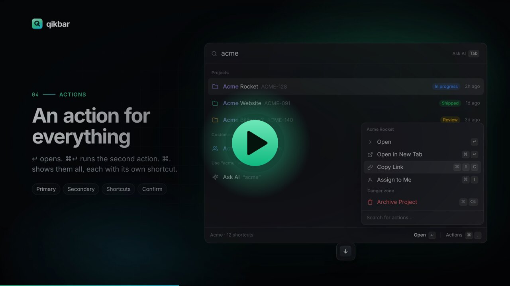

<p align="center">
  <picture>
    <source media="(prefers-color-scheme: dark)" srcset="assets/logo-wordmark-dark.svg">
    
  </picture>
</p>

<p align="center">
  <strong>The open-source command bar for any web app.</strong><br>
  Raycast-style search, routing, actions, extensions and AI in one tiny, themeable package.
</p>

<p align="center">
  <a href="https://qikbar.com">Website</a> ·
  <a href="https://qikbar.com/docs">Docs</a> ·
  <a href="https://qikbar.com/extensions">Extensions</a> ·
  <a href="https://qikbar.com/themes">Theme builder</a> ·
  <a href="https://qikbar.com/playground">Playground</a> ·
  <a href="https://qikbar.com/llms.txt">llms.txt</a>
</p>

<p align="center">
  <a href="https://qikbar.com/video/qikbar.mp4">
    
  </a>
  <br>
  <sub><a href="https://qikbar.com/video/qikbar.mp4">Watch the 76-second film</a> (sound on)</sub>
</p>

---

```bash
npm install @qikbar/qikbar
```

```ts
import { createQikbar } from '@qikbar/qikbar'

createQikbar({
  routes: [
    { path: '/', title: 'Dashboard', icon: 'home' },
    { path: '/settings', title: 'Settings', icon: 'settings' },
  ],
  commands: [{ title: 'New project', icon: 'plus', shortcut: 'c p', run: () => openNewProject() }],
  sources: [{
    id: 'projects',
    title: 'Projects',
    search: ({ query, signal }) => fetch(`/api/projects?q=${query}`, { signal }).then((r) => r.json()),
  }],
})
```

Press <kbd>⌘K</kbd>.

## Features

- **Instant fuzzy search**: word-boundary and acronym aware, frecency-ranked, highlighted. About 3 ms for 10,000 items.
- **Routing**: works with Next.js, React Router, Vue, SvelteKit, Astro, or plain links. `autoIndex` can turn your nav into commands with no config.
- **Views**: push lists, grids, Markdown details (streamable), forms and AI chats, with breadcrumbs and back.
- **Actions**: primary and secondary actions, a Raycast-style action panel (<kbd>⌘.</kbd>), shortcuts, inline arguments, confirmations and toasts.
- **Live sources**: search your API as the user types, with debouncing and cancellation.
- **AI that acts**: <kbd>Tab</kbd> to ask. The model can run your commands, search your sources and read the page. Works with Claude, GPT, Gemini, Ollama, any OpenAI-compatible API, Chrome's on-device model, a server proxy, or the user's own key. No SDKs.
- **Extensions**: package commands, sources, AI tools and preferences into a portable bundle, inspired by Raycast. Six are built in, and [eleven examples](apps/web/src/extensions) cover weather, currency, npm, Wikipedia, bookmarks, GitHub and more.
- **Theming**: 14 presets, 30+ CSS variables, automatic light and dark, Tailwind-friendly slot classes, or unstyled.
- **Tiny and fast**: zero dependencies, about 3.5 KB to boot, the UI loads when the browser is idle, and virtualized lists handle 100k rows.
- **Accessible**: ARIA combobox and listbox, focus management, reduced motion.

## Set it up with one prompt

Paste [this prompt](https://qikbar.com/prompt.txt) into Claude Code, Cursor, Copilot or Codex. The agent reads your router, pages and API, then wires Qikbar into your app. The full docs for agents are at [qikbar.com/llms-full.txt](https://qikbar.com/llms-full.txt).

## Packages

| Import | What |
| --- | --- |
| `@qikbar/qikbar` | `createQikbar`, view helpers, AI providers, types |
| `@qikbar/qikbar/react` | `<Qikbar>`, `useQikbar`, `useCommands`, `useSource`, `useExtension`, `<QikbarTrigger>` |
| `@qikbar/qikbar/extensions` | `calculator`, `themeSwitcher`, `page`, `aiActions`, `shortcuts` |
| `@qikbar/qikbar/server` | `createHandler` AI proxy for Next.js, Hono, Express, Bun, Workers… |
| `@qikbar/qikbar/theme` | Presets and theme helpers |
| `@qikbar/qikbar/utils` | The fuzzy matcher, Markdown renderer, icons, hotkeys |

A script-tag build is also available: `<script src="https://unpkg.com/@qikbar/qikbar/dist/qikbar.global.js"></script>`.

## Repository

```
packages/qikbar   The library (TypeScript, zero dependencies)
apps/web          qikbar.com: marketing site, docs, recipes, playground, theme builder, extensions (Astro)
examples/vanilla  A plain HTML example
examples/react    A React + Vite example
```

```bash
bun install
bun run build      # library + website
bun run test       # library tests (vitest + happy-dom)
bun run dev        # website at http://localhost:4321
```

## Contributing

Issues, extensions, themes and docs fixes are all welcome. See [CONTRIBUTING.md](CONTRIBUTING.md).

## Brand

The logo lives in [`assets/`](assets): `logo.svg` (mark), `logo-wordmark-dark.svg` and `logo-wordmark-light.svg`, plus PNGs. Run `bun run --filter @qikbar/web brand` to regenerate favicons and app icons after changing it.

## License

[MIT](LICENSE). Qikbar started as a hosted SaaS and is now free and open source.
